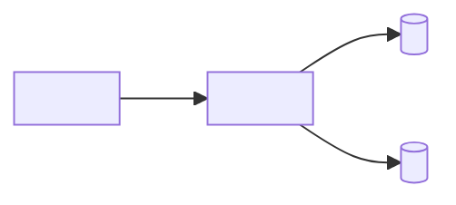

## Mermaid snippets

System context (only when the profile creates diagrams):


Container view:


Per-module diagram (one per `modules:` entry in `architecture.yaml`):
```mermaid
graph LR
  subgraph <module>
    entry[<entry point>] --> core[<core component>]
    core --> store[(<store>)]
  end
  <consumer> -.->|depends_on <InterfaceName>| entry
```

Integration (module-level DAG mirroring `depends_on_modules`):
```mermaid
graph LR
  <module-a> --> <module-b>
  <module-c> --> <module-a>
```
