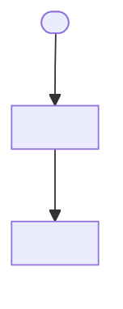
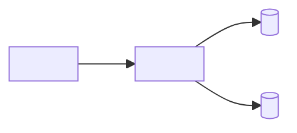

## Mermaid snippets

System context (only when the profile creates diagrams):


Container view:


## Per-module diagram (LARGE)

Rules: one flowchart per `modules:` entry in `architecture.yaml` showing internal components (≤6 nodes) plus inbound `depends_on_modules` edges (consumer → provider), plus ONE integration diagram wiring modules as atomic nodes. **Hard limit:** ≤15 nodes per diagram. Skip diagrams for trivial or single-module flows.

<module> (internals + inbound `depends_on` edge):
```mermaid
graph LR
  subgraph <module>
    entry[<entry point>] --> core[<core component>]
    core --> store[(<store>)]
  end
  <consumer> -.->|depends_on <InterfaceName>| entry
```

Integration (module-level DAG mirroring `depends_on_modules`):
```mermaid
graph LR
  <module-a> --> <module-b>
  <module-c> --> <module-a>
```
