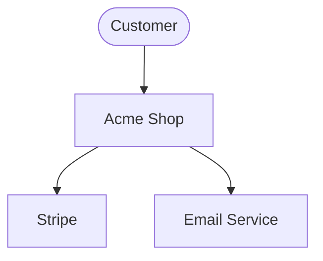
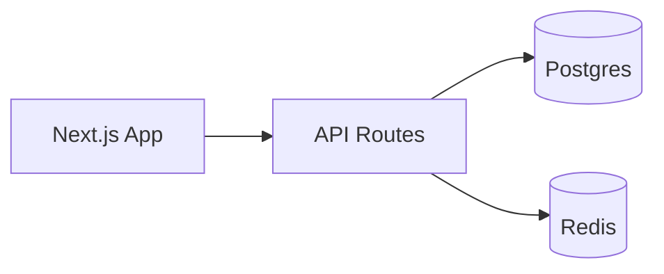
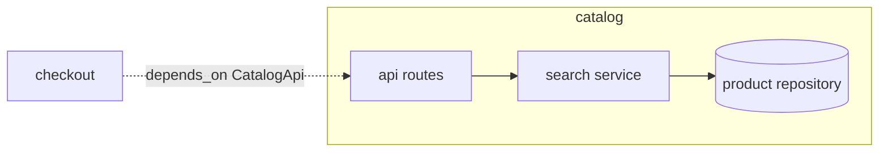
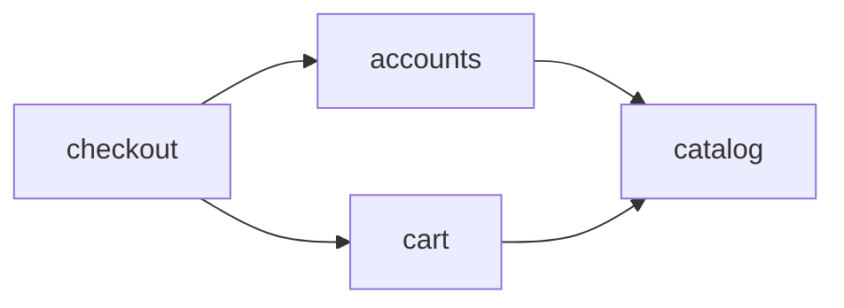

## Mermaid snippets

C4 context:

Container:

## Per-module diagram (LARGE)

For EACH `modules:` entry in architecture.yaml, one small flowchart of its
internal components plus its `depends_on_modules` edges (arrow points from
consumer to provider). Plus ONE integration diagram wiring all modules —
edges between modules only, no internals. HARD LIMIT: ≤15 nodes per diagram;
split into two diagrams rather than cramming. Internals stay ≤6 nodes per
module.

Catalog module (internal + inbound depends_on edge):

Integration (modules as atoms, mirrors depends_on_modules):

