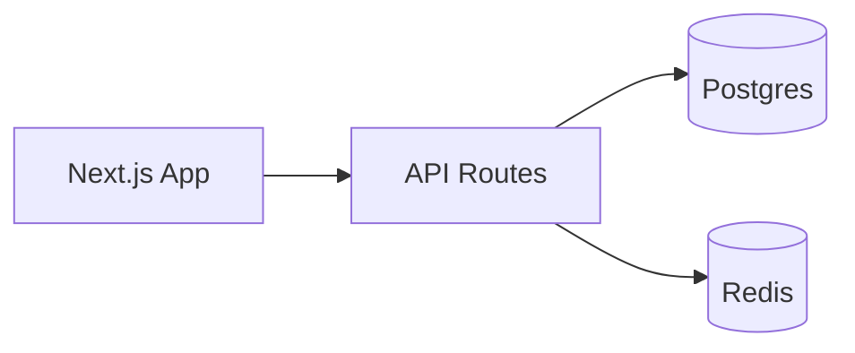
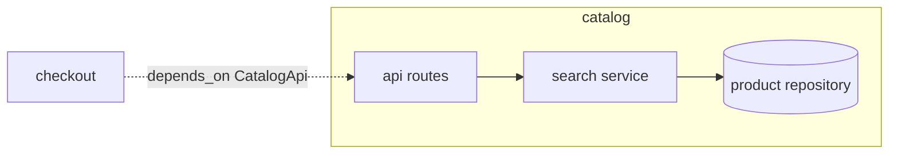
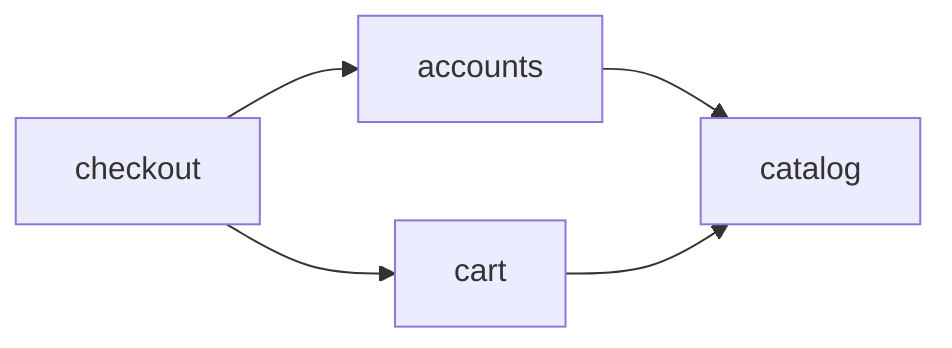

## Mermaid snippets

C4 context:

Container:

## Per-module diagram (LARGE)

Rules: One flowchart per `modules:` entry in `architecture.yaml` showing internal components (≤6 nodes) + inbound `depends_on_modules` edges (consumer → provider), plus ONE integration diagram wiring modules as atomic nodes. **Hard limit:** ≤15 nodes per diagram.

Catalog module (internals + inbound `depends_on` edge):

Integration (module-level DAG mirroring `depends_on_modules`):

